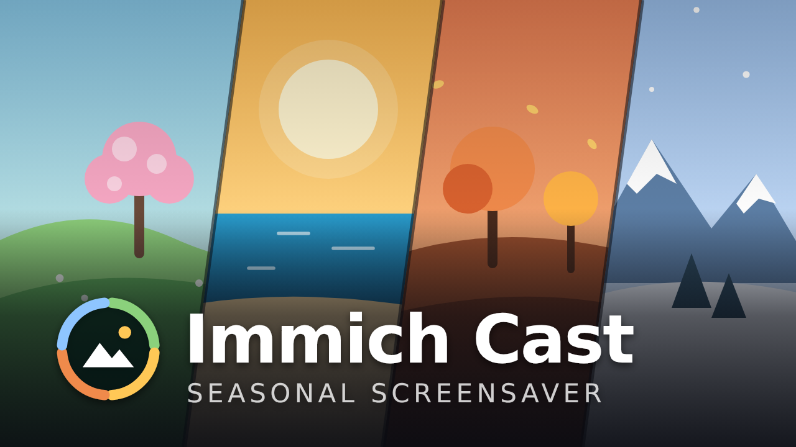
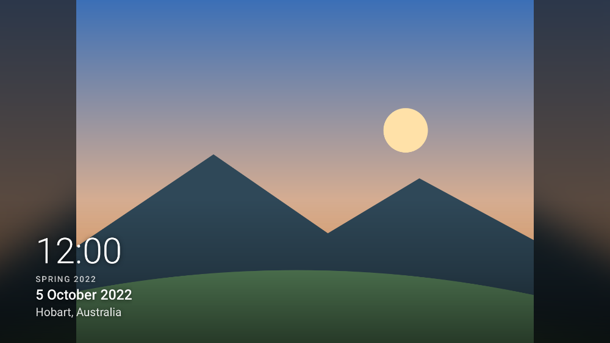
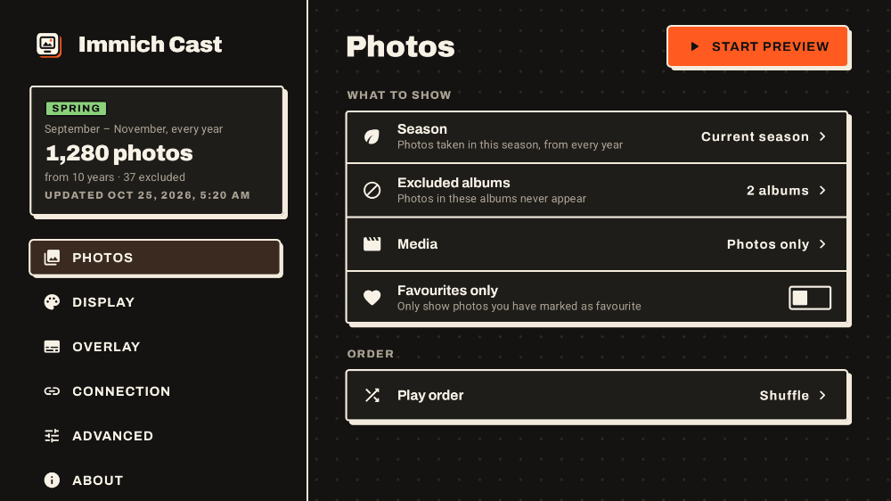
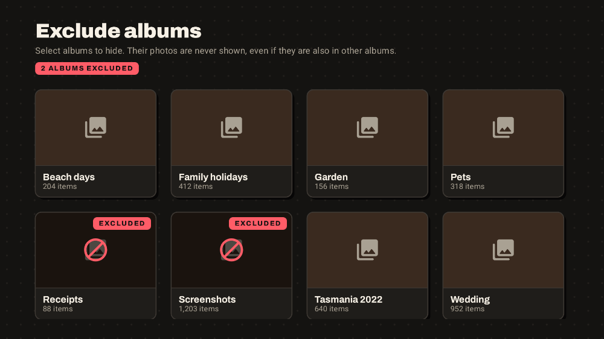
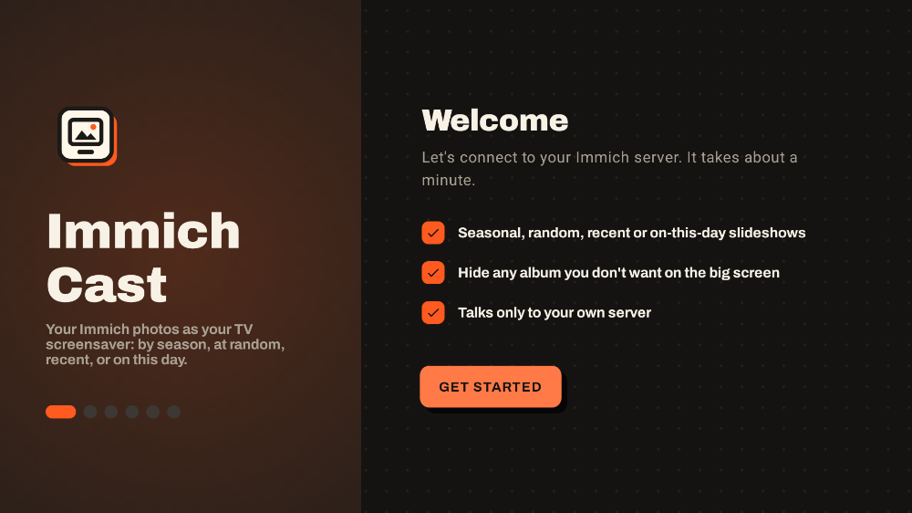

# Immich Cast

<p align="center"></p>

<p align="center">
  <a href="https://immich.app">
    <picture>
      <source media="(prefers-color-scheme: dark)" srcset="docs/immich/immich-logo-inline-dark.svg">
      
    </picture>
  </a>
  <br>
  <sub>A screensaver for your self-hosted <a href="https://immich.app">Immich</a> library</sub>
</p>

A screensaver for **Chromecast with Google TV** (and other Android TV / Google TV devices) that shows your [Immich](https://immich.app) photos: **season by season**, **this month** in past years, **at random**, **recent** ones, or **on this day**.

It shows photos from the current season across every year in your library: in spring you see every September–November from every year. You can limit it to **chosen albums**, or **exclude albums**. A photo in an excluded album never appears, even if it is also in another album.

<p align="center">
  
  
</p>
<p align="center">
  
  
</p>

## Features

- **Five slideshow modes:**
  - **Seasonal:** photos from the current season across every year (details below).
  - **This month:** the current calendar month in every year.
  - **Random:** your whole library, shuffled.
  - **Recent:** the last 30 days, 90 days, 6 months or 12 months.
  - **On this day:** the week around today's date in every past year. It changes daily.
- **Seasons** follow the Southern Hemisphere meteorological calendar:

  | Season | Months | Notes |
  |---|---|---|
  | Spring | Sep–Nov | |
  | Summer | Dec–Feb | Spans the new year |
  | Autumn | Mar–May | |
  | Winter | Jun–Aug | |

  The season switches automatically, or you can pin one. If the current season, month, recent span or day has no photos yet, the screensaver falls back to your whole library and says so.
- **Included albums.** Pick albums to limit the slideshow to (family, holidays, pets). Every mode then only uses photos from those albums.
- **Excluded albums.** Pick albums to hide (receipts, screenshots, work), and every photo in them is left out. Exclusions win over inclusions.
- **Everything configurable.** All of these are set with the remote:
  - time per photo, and a separate limit for videos
  - transition (crossfade, slow zoom, none)
  - image quality (fast previews, or full-quality originals for 4K)
  - fit (blurred background, crop to fill, black bars)
  - dimming
  - photos only, or photos and videos
  - favourites only
  - play order
  - overlay contents and position
- **360° photos and panoramas.** 360° photos and videos are shown from the inside, turning slowly through a full circle. Panoramas fill the screen height and pan from one end to the other. Both stay up for at least 30 seconds, or can be shown flat.
- **No clutter by default.** The overlay is off. Turn on any of: clock, date taken, location, album name, description, season.
- **Kind to your TV.** The overlay drifts slightly with each photo and moves to the opposite side every 10 minutes, so it doesn't burn into OLED and plasma screens.
- **Fast and resilient.** The photo list is cached on the device, so the screensaver starts at once and keeps working through Wi-Fi blips. The next photo is preloaded and decoded before it is shown. Shuffle reshuffles every time the screensaver starts.
- **Private.** It talks only to your Immich server, nothing else. There is no analytics or tracking.
- **Warm, remote-friendly design.** Subtle outlines and offset shadows, Archivo type and an orange accent, softened for a dark TV room. The focused item gets a warm tint and an orange outline, so you can always see where you are from the sofa.

## Installation

**👉 [Download the latest APK](https://github.com/roylet/Immich-Cast/releases/latest), then follow the step-by-step guide: [INSTALL.md](INSTALL.md)**

It covers downloading the APK, installing adb on Windows, Mac or Linux, turning on developer options on the Chromecast, installing and setting up the app, making it the screensaver, updating, and switching back. Allow about 15 minutes, once.

You'll need:

- a Chromecast with Google TV, or any Google TV / Android TV device on Android 12 or later
- an Immich server the TV can reach
- a computer on the same Wi-Fi network

The short version, if you already know adb:

```sh
adb connect <tv-ip>:5555
adb install immich-cast-<version>.apk
# open Immich Cast on the TV and connect it to your server, then:
adb shell settings put secure screensaver_components com.roylet.immichcast/.dream.PhotoDreamService
```

## Settings reference

| Setting | Options | Default |
|---|---|---|
| Show | Seasonal, This month, Random, Recent, On this day | Seasonal |
| Season (Seasonal) | Current season, Spring, Summer, Autumn, Winter | Current season |
| Time span (Recent) | Last 30 days, 90 days, 180 days, 12 months | Last 90 days |
| Included albums | Any of your albums (owned or shared) | All albums |
| Excluded albums | Any of your albums (owned or shared) | None |
| Media | Photos only, Photos and videos | Photos only |
| Favourites only | On / Off | Off |
| Play order (not shown for Random) | Shuffle, Oldest first, Newest first | Shuffle |
| Time per photo | 10 s – 5 min | 30 seconds |
| Time per video (with videos on) | None (play to the end, up to 2 min), 10 s, 20 s, 30 s, 1 min | None |
| Transition | Crossfade, Slow zoom, None | Crossfade |
| Image quality | Standard (~1440 px preview), Full quality (original) | Standard |
| Image fit | Fit with blurred background, Fill (crop), Fit with black bars | Blurred background |
| 360° and panoramas | Look around, Show flat | Look around |
| 360° turn speed | Slow (60 s a turn), Medium (40 s), Fast (20 s), Very fast (12 s) | Fast |
| Dim | Off – 60% | Off |
| Overlay | Clock, Date taken, Location, Album name, Description, Season | All off |
| Overlay position | Any corner | Bottom left |
| Clock format | System, 12-hour, 24-hour | System |
| Refresh library every | 6, 12, 24 hours | 12 hours |

## How it works

The app builds its photo list with Immich's search API:

1. It works out the date ranges for the chosen mode. For Seasonal, This month and On this day, it reads your timeline so it only queries years that have photos. Random uses no date filter.
2. It queries each range with `POST /api/search/metadata`. With included albums, it fetches each album once and applies the dates on the TV instead.
3. It removes every asset found in your excluded albums.

Archived, hidden, locked and trashed photos are never shown. The list is cached on the TV and rebuilt in the background on your refresh interval, when the season, month or day changes (for date-based modes), or when you change a setting that affects which photos are picked. A rebuilt list is swapped in straight away, without restarting the screensaver.

Tested with Immich 3.3.

## Development

```sh
./gradlew assembleRelease        # APK at app/build/outputs/apk/release/app-release.apk
./gradlew testDebugUnitTest      # unit tests and screenshot rendering
./gradlew lintDebug
./gradlew recordPaparazziDebug   # re-render UI screenshots to app/src/test/snapshots
node art/render.js               # regenerate the TV banner and screensaver preview from art/banner.html
```

The code lives in `app/src/main/java/com/roylet/immichcast/`:

| Package | What it holds |
|---|---|
| `core/` | Season maths, options and playlist rules (plain Kotlin, fully unit tested) |
| `api/` | Small Immich REST client |
| `data/` | Settings storage and the cached playlist repository |
| `dream/` | The screensaver: `DreamService`, slideshow view, transitions, overlay |
| `ui/` | Settings and setup wizard, built with Compose for TV |

The app's TV banner is drawn in `art/banner.html` and rendered to PNGs by `art/render.js` (uses Playwright). The launcher icon is pure vector: `res/drawable/ic_launcher_*.xml`. The theme's colours and building blocks (outlined cards, offset shadows, focus states) live in `ui/theme/`.

### Release signing

Release builds use the debug key unless one of these is provided:

- a `keystore.properties` file at the repo root, with `storeFile`, `storePassword`, `keyAlias` and `keyPassword`, or
- these repository secrets for CI:
  - `IMMICH_CAST_KEYSTORE_BASE64`
  - `IMMICH_CAST_KEYSTORE_PASSWORD`
  - `IMMICH_CAST_KEY_ALIAS`
  - `IMMICH_CAST_KEY_PASSWORD`

To publish a release, bump `versionName`/`versionCode` in `app/build.gradle.kts`, then either push a matching tag (e.g. `v1.0.2`) or open **Actions → Build → Run workflow**, pick the branch and tick **release**. The workflow tags the commit, creates the GitHub release and attaches the APK.

Builds from a fork are signed with a different key, so they can't be installed over the official release without uninstalling it first.

## Contributing

Bug reports and pull requests are welcome. Please run `./gradlew testDebugUnitTest lintDebug` before opening a pull request, and re-record screenshots if you change the UI.

## License and credits

Immich Cast is released under the [MIT License](LICENSE).

- The bundled [Archivo](https://fonts.google.com/specimen/Archivo) font is under the SIL Open Font License (`licenses/Archivo-OFL.txt`).
- The sample photo in the screensaver screenshot is ["Pink moon" over Derwent, Hobart](https://commons.wikimedia.org/wiki/File:%22Pink_moon%22_over_Derwent,_Hobart,_April_2021.jpg) by [Thomas & Olivia Williams](https://www.flickr.com/photos/thomasswilliams/51164720553/), licensed [CC BY 2.0](https://creativecommons.org/licenses/by/2.0/). It was resized and has the app's overlay drawn on top.
- The Immich name and logo belong to the [Immich](https://github.com/immich-app/immich) project and are used only to show what this app works with.

---

Immich Cast is an independent project and is not affiliated with or endorsed by Immich or FUTO.
